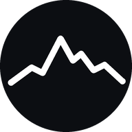
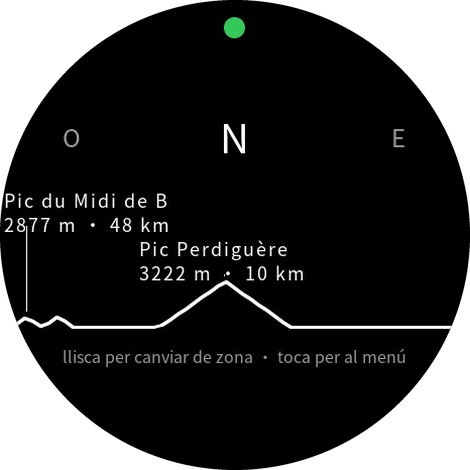
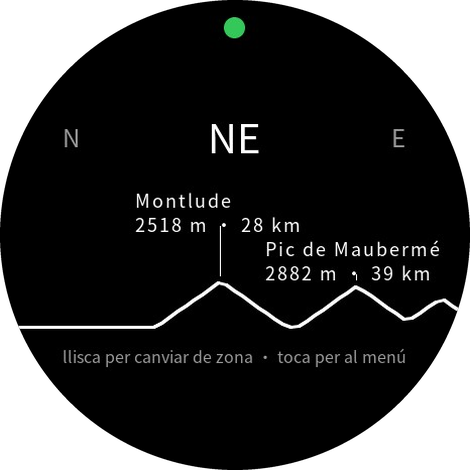
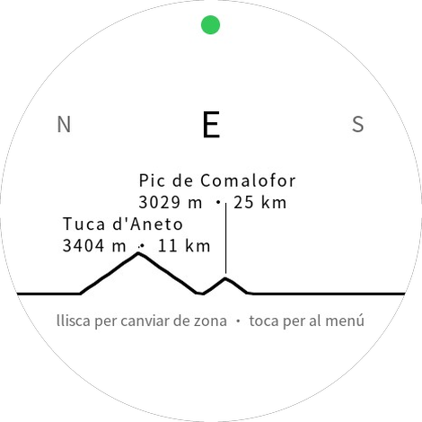
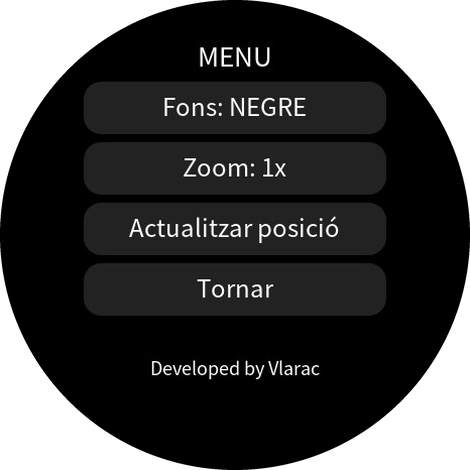

# Peak Finder per al Huawei Watch GT 6

[English](README.md) · **Català** · [Español](README.es.md)

Un identificador de cims per al canell. Mira al teu voltant i el rellotge et mostra els cims més alts en aquella direcció, amb nom, altura i distància. Sense mòbil, sense compte i sense xarxa.

Fet per al Huawei Watch GT 6 (HarmonyOS, pantalla rodona de 466×466) amb el framework JS Lite Wearable de HarmonyOS.

  
  
  
  

_Captures del simulador de DevEco amb la posició de Benasc (Pirineu), no fotos del rellotge._

## Funcions

- **Seccions al teu voltant:** el cercle es parteix en seccions centrades en els punts cardinals: 4 de 90° (N, E, S, O), 8 de 45° (amb NE, SE…) o 16 de 22,5° (amb NNE, ENE…), segons el zoom (1x, 2x, 4x).
- **Els 3 cims més alts de cada secció**, amb nom, altura i distància, i una ratlla fina des de cada nom fins al seu cim sobre una silueta senzilla.
- **Lliscar** a l'esquerra o a la dreta canvia a la secció següent o l'anterior. Tocar la pantalla obre el menú.
- **Punt de brúixola a la vora:** un punt segueix la vora de dalt de la pantalla com una brúixola: verd si mires cap al centre de la secció, vermell a l'esquerra o a la dreta si t'has de girar.
- **Menú:** fons negre o blanc, zoom i actualitzar la posició.
- **Sense connexió:** l'app porta uns 420 cims d'OpenStreetMap (Pirineu i Catalunya, fins a 150 km). El GPS es llegeix una sola vegada.
- **Recorda** la posició, el fons i el zoom si el sistema tanca l'app.

## Convé saber

- La vista és geomètrica: mostra el que veuries en un dia perfectament clar. No coneix el terreny més baix que podria tapar un cim, així que un gegant llunyà com l'Aneto des de Lleida hi surt tot i que la calitja el sol amagar.
- El GPS necessita el cel: a l'aire lliure pot trigar un minut. La brúixola va millor si la calibres (dibuixa un 8 a l'aire).
- La declinació magnètica és fixa, 1,5° (Pirineu).

## Instal·lació

No hi ha cap versió a la botiga. T'ho compiles i t'ho instal·les tu:

1. Instal·la [DevEco Studio](https://developer.huawei.com/consumer/en/deveco-studio/) i obre aquesta carpeta.
2. A **File > Project Structure > Signing Configs**, genera la teva pròpia signatura de depuració (cal un compte de desenvolupador de Huawei i el teu rellotge registrat com a dispositiu de prova).
3. Instal·la l'app **DevEco Assistant** al mòbil i connecta-hi el rellotge. Huawei fa aquest pas força embolicat, així que tingues una mica de paciència.
4. Instal·la el `.hap` signat al rellotge amb DevEco Assistant: o bé executes el projecte des de DevEco Studio, o bé copies el `.hap` compilat al mòbil i l'instal·les des de l'app. Desinstal·la abans qualsevol versió anterior.

Els fitxers de signatura (`.p12`, `.p7b`, `.cer`) no formen part d'aquest repositori.

## Estructura del projecte

| Fitxer | Què fa |
| --- | --- |
| `entry/src/main/js/MainAbility/pages/index/index.js` | Seccions, lliscar, punt de brúixola, menú, GPS, desar i carregar |
| `.../index.hml` | Disseny: secció, avís de «cap cim a prop», menú i pantalla d'espera |
| `.../index.css` | Estil per a la pantalla rodona de 466×466 (els colors venen de dades, així el negre/blanc funciona) |
| `entry/src/main/js/MainAbility/common/geo.js` | Distància, rumb, angle d'elevació i els cims més alts d'una secció |
| `entry/src/main/js/MainAbility/common/peaks.js` | Els cims, en una cadena de línies `lat,lon,altura,nom` (generat) |
| `data/build_peaks.py` | Descarrega els cims d'OpenStreetMap i escriu `peaks.js` |
| `tests/` | `node tests/test_geo.js`, `test_page.js` (la pàgina amb sensors i canvas falsos) i `test_theme.js` (colors negre/blanc) |
| `entry/src/main/config.json` | Nom del paquet, permisos, versió |

`@system.storage` als rellotges lleugers només guarda uns 128 bytes per valor, així que la posició es desa com un text curt separat per comes. El canvas dels rellotges lleugers no té `clearRect` i només dibuixa text amb la lletra `HarmonyOS Sans`; el codi i les proves ho tenen en compte.

## Dades i llicències

- Codi: [MIT](LICENSE).
- Dades de cims: © col·laboradors d'[OpenStreetMap](https://www.openstreetmap.org/copyright), [ODbL](https://opendatacommons.org/licenses/odbl/).

## Versió

Actual: **0.1.44**

---

Developed by [Vlarac](https://github.com/Vlarac03)
