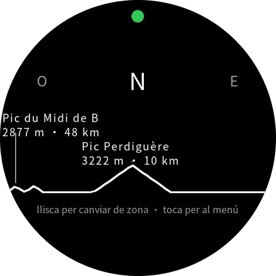
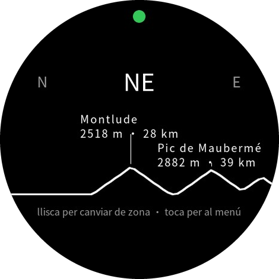
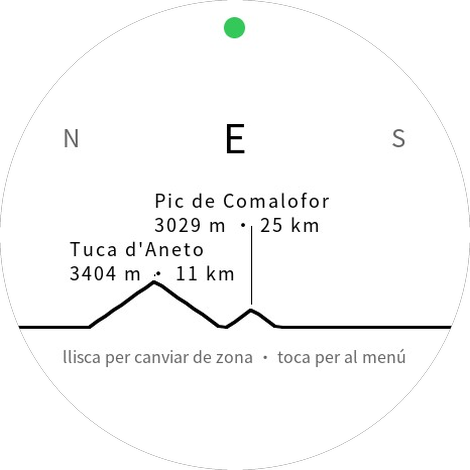
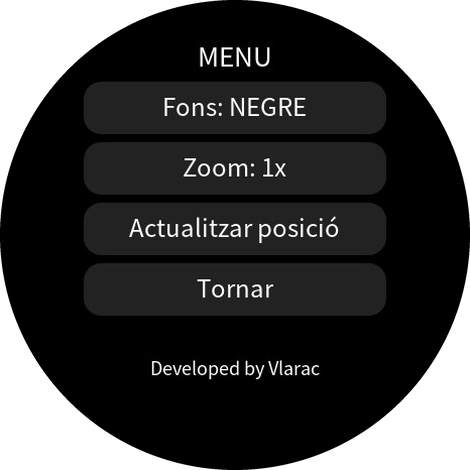

# Peak Finder para el Huawei Watch GT 6

[English](README.md) · [Català](README.ca.md) · **Español**

Un identificador de cimas para la muñeca. Mira a tu alrededor y el reloj te muestra las cimas más altas en esa dirección, con nombre, altura y distancia. Sin móvil, sin cuenta y sin red.

Hecho para el Huawei Watch GT 6 (HarmonyOS, pantalla redonda de 466×466) con el framework JS Lite Wearable de HarmonyOS.

  
  
  
  

_Capturas del simulador de DevEco con la posición de Benasque (Pirineo), no fotos del reloj._

## Funciones

- **Secciones a tu alrededor:** el círculo se parte en secciones centradas en los puntos cardinales: 4 de 90° (N, E, S, O), 8 de 45° (con NE, SE…) o 16 de 22,5° (con NNE, ENE…), según el zoom (1x, 2x, 4x).
- **Las 3 cimas más altas de cada sección**, con nombre, altura y distancia, y una línea fina desde cada nombre hasta su cima sobre una silueta sencilla.
- **Deslizar** a izquierda o derecha cambia a la sección siguiente o la anterior. Tocar la pantalla abre el menú.
- **Punto de brújula en el borde:** un punto sigue el borde superior de la pantalla como una brújula: verde si miras al centro de la sección, rojo a izquierda o derecha si debes girar.
- **Menú:** fondo negro o blanco, zoom y actualizar la posición.
- **Sin conexión:** la app lleva unas 420 cimas de OpenStreetMap (Pirineo y Cataluña, hasta 150 km). El GPS se lee una sola vez.
- **Recuerda** la posición, el fondo y el zoom si el sistema cierra la app.

## Conviene saber

- La vista es geométrica: muestra lo que verías en un día perfectamente claro. No conoce el terreno más bajo que podría tapar una cima, así que un gigante lejano como el Aneto desde Lleida aparece aunque la calima suela esconderlo.
- El GPS necesita el cielo: al aire libre puede tardar un minuto. La brújula va mejor si la calibras (dibuja un 8 en el aire).
- La declinación magnética es fija, 1,5° (Pirineo).

## Instalación

No hay versión en la tienda. Lo compilas e instalas tú:

1. Instala [DevEco Studio](https://developer.huawei.com/consumer/en/deveco-studio/) y abre esta carpeta.
2. En **File > Project Structure > Signing Configs**, genera tu propia firma de depuración (hace falta una cuenta de desarrollador de Huawei y tu reloj registrado como dispositivo de prueba).
3. Instala la app **DevEco Assistant** en el móvil y conecta el reloj a través de ella. Huawei hace este paso bastante lioso, así que ten paciencia.
4. Instala el `.hap` firmado en el reloj con DevEco Assistant: o ejecutas el proyecto desde DevEco Studio, o copias el `.hap` compilado al móvil y lo instalas desde la app. Desinstala antes cualquier versión anterior.

Los archivos de firma (`.p12`, `.p7b`, `.cer`) no forman parte de este repositorio.

## Estructura del proyecto

Archivos

| Archivo | Qué hace |
| --- | --- |
| `entry/src/main/js/MainAbility/pages/index/index.js` | Secciones, deslizar, punto de brújula, menú, GPS, guardar y cargar |
| `.../index.hml` | Diseño: sección, aviso de «ninguna cima cerca», menú y pantalla de espera |
| `.../index.css` | Estilo para la pantalla redonda de 466×466 (los colores vienen de datos, así el negro/blanco funciona) |
| `entry/src/main/js/MainAbility/common/geo.js` | Distancia, rumbo, ángulo de elevación y las cimas más altas de una sección |
| `entry/src/main/js/MainAbility/common/peaks.js` | Las cimas, en una cadena de líneas `lat,lon,altura,nombre` (generado) |
| `data/build_peaks.py` | Descarga las cimas de OpenStreetMap y escribe `peaks.js` |
| `tests/` | `node tests/test_geo.js`, `test_page.js` (la página con sensores y canvas falsos) y `test_theme.js` (colores negro/blanco) |
| `entry/src/main/config.json` | Nombre del paquete, permisos, versión |

`@system.storage` en los relojes ligeros solo guarda unos 128 bytes por valor, así que la posición se guarda como un texto corto separado por comas. El canvas de los relojes ligeros no tiene `clearRect` y solo dibuja texto con la fuente `HarmonyOS Sans`; el código y las pruebas lo tienen en cuenta.

## Datos y licencias

- Código: [MIT](LICENSE).
- Datos de cimas: © colaboradores de [OpenStreetMap](https://www.openstreetmap.org/copyright), [ODbL](https://opendatacommons.org/licenses/odbl/).

## Versión

Actual: **0.1.44**

---

Developed by [Vlarac](https://github.com/Vlarac03)
