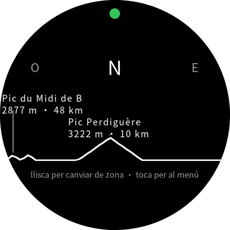
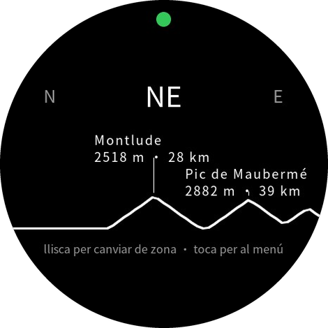
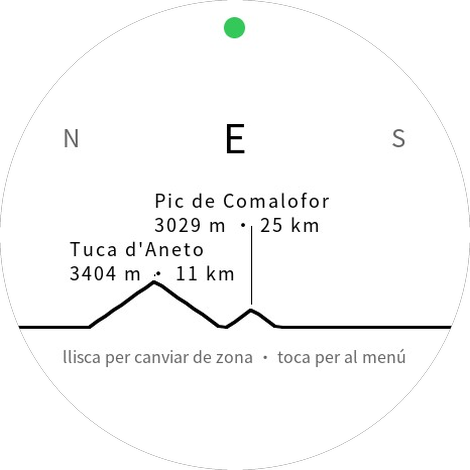
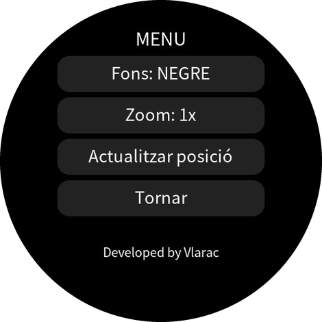

# Peak Finder for Huawei Watch GT 6

**English** · [Català](README.ca.md) · [Español](README.es.md)

A peak finder for your wrist. Look around, and the watch shows the highest peaks in that direction, with their name, height and distance. No phone, no account, no network.

Built for the Huawei Watch GT 6 (HarmonyOS, 466×466 round display) with the HarmonyOS Lite Wearable JS framework.

  
  
  
  

_Renders from the DevEco simulator with the position of Benasque (Pyrenees), not photos of the watch._

## Features

- **Sections around you:** the circle is split into sections centred on the cardinal points: 4 of 90° (N, E, S, O), 8 of 45° (with NE, SE…) or 16 of 22.5° (with NNE, ENE…), depending on the zoom (1x, 2x, 4x).
- **The 3 highest peaks of each section**, with name, height and distance, and a thin line from each name to its summit over a simple ridge outline.
- **Swipe** left or right to go to the next or previous section. Tap the screen for the menu.
- **Compass dot on the rim:** a dot follows the top edge of the screen like a compass: green when you look at the centre of the section, red to the left or right when you have to turn.
- **Menu:** black or white background, zoom, and update position.
- **Offline:** about 420 peaks from OpenStreetMap (Pyrenees and Catalonia, up to 150 km away) are bundled in the app. GPS is read once.
- **Remembers** your position, background and zoom if the system closes the app.

## Good to know

- The view is geometric: it shows what you would see on a perfectly clear day. It does not know about lower terrain that could hide a peak, so a far giant such as the Aneto from Lleida shows up even though haze usually hides it.
- GPS needs the sky: it can take a minute outdoors. The compass works better after calibrating it (draw an 8 in the air).
- The magnetic declination is a fixed 1.5° (Pyrenees).

## Install

There is no store release. You build and install it yourself:

1. Install [DevEco Studio](https://developer.huawei.com/consumer/en/deveco-studio/) and open this folder.
2. In **File > Project Structure > Signing Configs**, generate your own debug signature (it needs a Huawei developer account and your watch registered as a test device).
3. Install the **DevEco Assistant** app on your phone and connect the watch through it. Huawei makes this step rather fiddly, so allow some time.
4. Install the signed `.hap` on the watch with DevEco Assistant: either run the project from DevEco Studio, or copy the built `.hap` to your phone and install it from the app. Uninstall any previous version first.

The signing files (`.p12`, `.p7b`, `.cer`) are not part of this repository.

## Project structure

| File | What it does |
| --- | --- |
| `entry/src/main/js/MainAbility/pages/index/index.js` | Sections, swipe, compass dot, menu, GPS, saving and loading |
| `.../index.hml` | Layout: section, "no peaks nearby" notice, menu and waiting screens |
| `.../index.css` | Styling for the round 466×466 display (colours come from data, so black/white works) |
| `entry/src/main/js/MainAbility/common/geo.js` | Distance, bearing, elevation angle and the highest peaks of a section |
| `entry/src/main/js/MainAbility/common/peaks.js` | The peaks, as one string of `lat,lon,height,name` lines (generated) |
| `data/build_peaks.py` | Downloads the peaks from OpenStreetMap and writes `peaks.js` |
| `tests/` | `node tests/test_geo.js`, `test_page.js` (the page with fake sensors and canvas) and `test_theme.js` (black/white colours) |
| `entry/src/main/config.json` | Bundle name, permissions, version |

`@system.storage` on lite wearables only holds about 128 bytes per value, so the position is saved as a short comma-separated string. The canvas of the lite wearables has no `clearRect` and only draws text with the `HarmonyOS Sans` font; the code and the tests take that into account.

## Data and licences

- Code: [MIT](LICENSE).
- Peak data: © [OpenStreetMap](https://www.openstreetmap.org/copyright) contributors, [ODbL](https://opendatacommons.org/licenses/odbl/).

## Version

Current: **0.1.44**

---

Developed by [Vlarac](https://github.com/Vlarac03)
